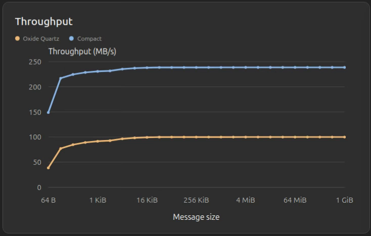
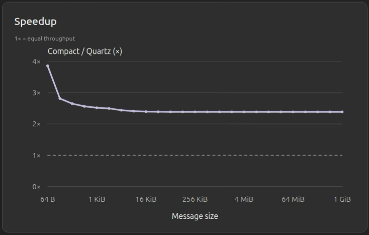
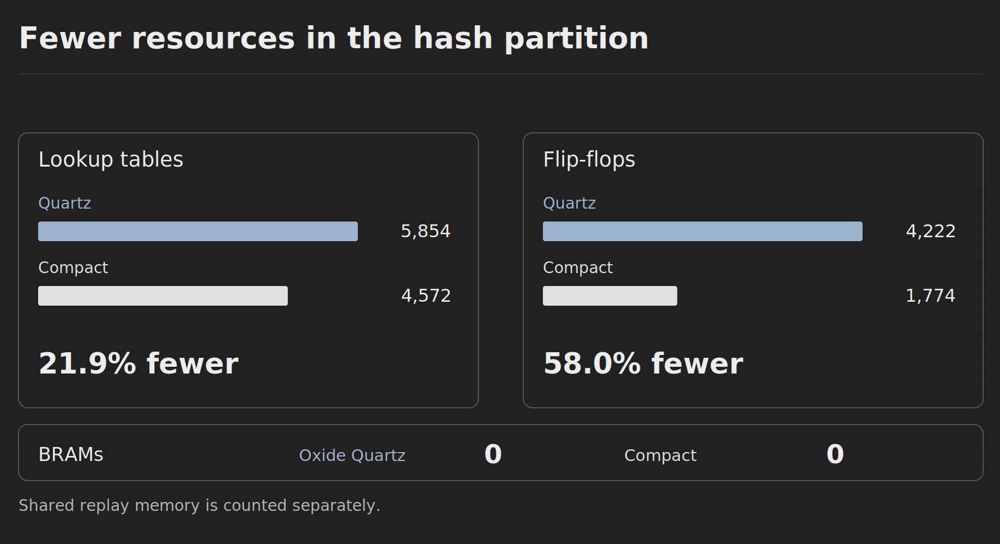
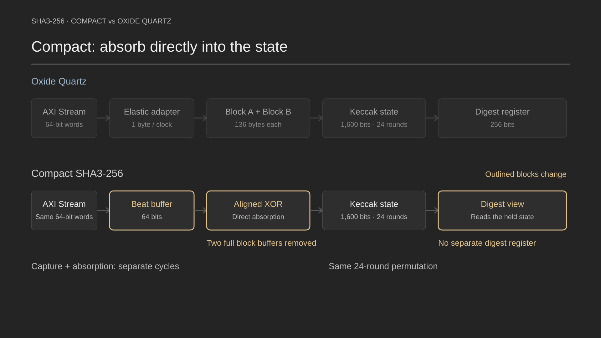

# FPGA SHA3-256 performance against Oxide Quartz

**[Open the FPGA DFX Hash Accelerator project →](https://github.com/rlongwell/fpga-dfx-hash-accelerator-public#fpga-dfx-hash-accelerator)**

Zybo Hash Lab is the tool behind this comparison. Its dashboard loads each core into the same FPGA partition, runs the same input through both, and checks their digests. The accelerator project includes the source and an illustrated tutorial for running the bench.

On the same Zybo Z7-20 at 100 MHz, the compact SHA3-256 core hashed 1 GiB in **4.500 s**. Oxide’s original Quartz core took **10.737 s** on the same input. The compact design delivered **2.386× the throughput** while using **21.9% fewer lookup tables** and **58.0% fewer flip-flops** in the hash partition.

The compact core is an independent implementation. A separate experiment changes one thing in Quartz itself and measures the cost of its digest register.

**Architecture and live FPGA demo · 4:08**

**[Watch the demo on mobile](https://rlongwell.github.io/oxide-sha3-comparison-public/)**

## What the board measured

Both cores took turns in the same FPGA partition, reading identical messages from on-chip replay memory. The FPGA timer ran from job start until the digest was ready. Loading the replay memory happened before timing began.

**Throughput.** Each point shows the median of seven runs at one message size. Quartz levels off near **100.0 MB/s** and the compact core reaches **238.6 MB/s**. Both cores matched the reference digest in all 350 timed runs and 50 warmups across 25 sizes. [Measurements by message size](evidence/sweep/summary.csv)

**Speedup.** Dividing the Quartz time by the compact time gives **3.86× at 64 B**. The ratio settles near **2.4×** for large messages. At 1 GiB that saves **6.24 seconds** per hash.

**FPGA resources.** The compact partition uses 1,282 fewer lookup tables and 2,448 fewer flip-flops. Both cores met the 100 MHz timing constraint and used zero block RAMs inside the hash partition. The shared replay memory sits in the static design. [Routed utilization and timing](evidence/routed/summary.json)

## What changed in the datapath

Both designs compute SHA3-256 with the same 24-round Keccak permutation. **Quartz** accepts one byte per clock and can fill a second block while it processes the first. The **compact core** captures up to eight bytes at once, absorbs them directly into the hash state on a later clock, and reads the digest from that state.

## A smaller change to Quartz itself

The VHDL patch returns the digest directly from the held Keccak state. In a standalone routed build it saved **183 LUTs and 255 flip-flops** with two buffers, or **135 LUTs and 265 flip-flops** with one. Each version took exactly as many simulated cycles as its upstream counterpart for a 64 KiB message. The replay charts above use the original Quartz baseline. [Patch, cycle counts and routed evidence](docs/comparison.md#removing-the-quartz-digest-register)

## Platform and tools

The recorded hardware runs used a **Digilent Zybo Z7-20** at 100 MHz. Both configurations were routed with **AMD Vivado 2024.2** on **Ubuntu 24.04 LTS x86-64**. The RTL tests use Verilator for the compact SystemVerilog core and NVC 1.23.1 for the Quartz VHDL. [Routed tool and device record](evidence/routed/compact/routed_timing.rpt)

Run `python3 scripts/verify_sweep.py` with Python 3 alone to check the recorded results. The [implementation and benchmark guide](docs/comparison.md) covers the cycle counts, raw measurements and simulation commands. Oxide Computer Company and the Quartz contributors authored the reference core. [Upstream source and credits](THIRD_PARTY_NOTICES.md)
